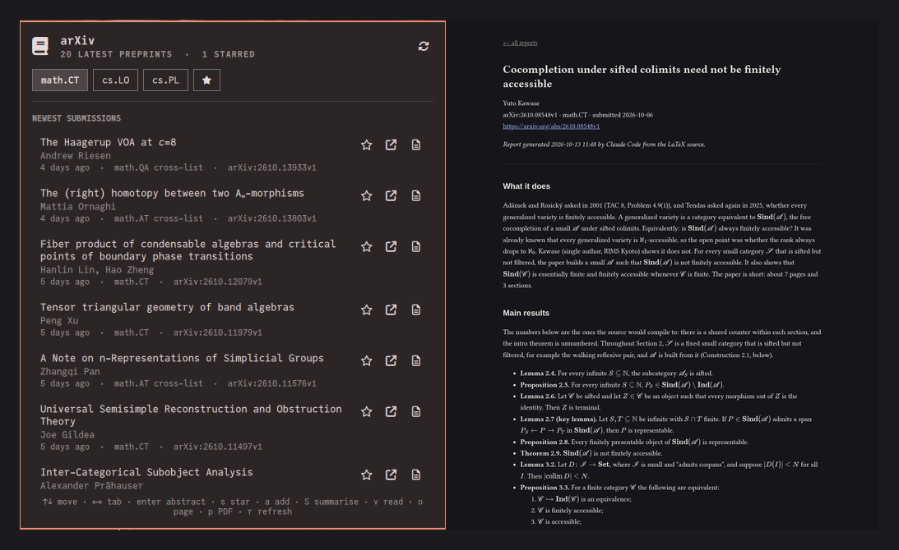

# arXiv Reader for Omarchy

The newest preprints of your arXiv categories in the Omarchy bar, and AI
reading reports on the ones you star, written for your own expertise.

> [!WARNING]
> This plugin was vibe coded with Claude Opus 5.5. By installing it, you
> accept that it is your responsibility to read and check the code yourself
> before using it. Like every Omarchy plugin, it runs unsandboxed inside
> `omarchy-shell` with your user's permissions.



**Full documentation: <https://pierrecagne.github.io/omarchy-arxiv/>**

## What it does

- **Browse.** One tab per arXiv category, newest submissions first, with
  authors, dates, cross-lists and the abstract one keypress away. TeX in
  titles and abstracts is rendered.
- **Star.** Press `s` on a preprint, or `a` to star any paper by its
  identifier or link.
- **Get reports.** Press `S` and an AI reads each starred paper in full,
  from its LaTeX source when arXiv has it, and writes a Markdown report:
  what it does, the main results stated precisely, the key ideas, how it
  works, the context and an assessment.
- **Read them.** Press `v` to open the reports in your browser, with the
  mathematics typeset by KaTeX. The Markdown files stay in a folder of your
  choice.

Reports are tuned to you:

- **Who they are for.** Describe your expertise, for example *"a working
  mathematician in categorical logic and type theory"* or *"an ML engineer
  who builds retrieval systems"*, and the report is pitched at that level.
- **Report style.** *Theory* (theorems, definitions, proof strategies),
  *Empirical* (claims, methods, evaluation, reproducibility), *Auto*, or your
  own prompt file.
- **AI engine.** Claude Code, Codex, or any command that reads a prompt on
  standard input and prints Markdown (`llm`, `ollama run …`, …), with an
  optional model.
- **Sandbox, on by default.** Claude Code and Codex can read only the paper
  being reported on, plus any folders you allow, such as your own notes, so
  reports can relate the paper to your work. They can never write files.

## Requirements

- Omarchy 4 (Quattro shell), with `python3` (shipped with Omarchy).
- For reports, one AI engine, installed and logged in:
  - [Claude Code](https://claude.com/claude-code) (`claude`). The sandbox
    needs a version with `--restricted` (tested with 2.1.295).
  - [Codex](https://github.com/openai/codex) (`codex`). The sandbox needs
    bubblewrap (`bwrap`): `omarchy pkg add bubblewrap`.
  - or any command-line LLM tool, used as a custom command.
- Optional: `pdftotext` and `pdfinfo` (poppler) for the rare PDF-only papers.

Browsing works without any AI engine.

## Install

```bash
omarchy plugin add https://github.com/pierrecagne/omarchy-arxiv.git --enable
```

The widget appears in the centre of the bar. Then set your categories and
who the reports are for, in `~/.config/omarchy/shell.json` or with
`omarchy bar set`:

```bash
omarchy bar set io.github.pierrecagne.arxiv categories "math.CT, cs.LO"
omarchy bar set io.github.pierrecagne.arxiv reader "a working mathematician in categorical logic"
omarchy bar set io.github.pierrecagne.arxiv reportStyle Theory
```

Every setting is described in the
[configuration guide](https://pierrecagne.github.io/omarchy-arxiv/configuration.html).

## Keys

In the panel: `↑` `↓` move, `←` `→` switch tab, `Enter` show the abstract,
`s` star, `a` star by identifier, `S` summarise the starred papers, `v` read
the reports, `o` arXiv page, `p` PDF, `r` refresh, `Esc` close.

From scripts and keybindings:

```bash
omarchy-shell io.github.pierrecagne.arxiv toggle
omarchy-shell io.github.pierrecagne.arxiv star 2401.12345
omarchy-shell io.github.pierrecagne.arxiv summarise
omarchy-shell io.github.pierrecagne.arxiv reports
```

## Privacy and security

- The widget talks to arXiv (`export.arxiv.org` for listings, `arxiv.org`
  for the papers you summarise), and once to `cdn.jsdelivr.net` to download
  KaTeX and marked for the report reader.
- Summarising sends the paper and the prompt to your AI engine's provider,
  under your own account. Nothing else is sent anywhere.
- Reports are written by a model from papers anyone can upload, so the
  sandbox is on by default, the prompt tells the model to treat the paper as
  material rather than instructions, and the local report reader (bound to
  `127.0.0.1`) shows raw HTML as text and blocks scripts, outside images and
  network requests.
- A custom command runs with your permissions: the sandbox setting does not
  apply to it.

Details: [privacy and security](https://pierrecagne.github.io/omarchy-arxiv/security.html).

## Remove

```bash
omarchy plugin remove io.github.pierrecagne.arxiv
```

To delete its state, cache and downloaded assets as well (your reports
folder is left alone):

```bash
rm -rf ~/.local/state/io.github.pierrecagne.arxiv ~/.cache/io.github.pierrecagne.arxiv
```

## License

[MIT](LICENSE).

Thank you to arXiv for use of its open access interoperability. This project
is not affiliated with or endorsed by arXiv. Claude Code is a product of
Anthropic and Codex of OpenAI; neither is affiliated with this project.
